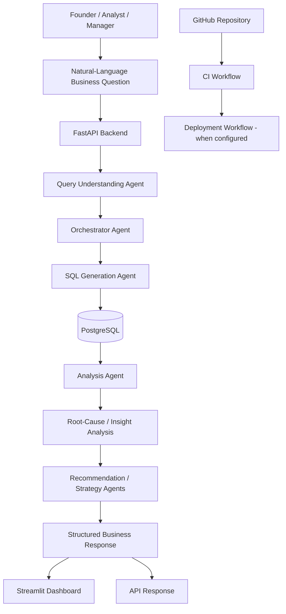

import pypandoc, os

content = r'''# Agentic AI for E-Commerce Business Intelligence & Strategic Decision Support

> **Tagline:** See what happened → Understand why → Know what to do next.

An AI-powered Business Intelligence (BI) project designed to help e-commerce decision-makers explore business performance using natural-language questions, KPI analysis, visualizations, root-cause investigation, and actionable strategic recommendations.

---

## Table of Contents

- [Project Overview](#project-overview)
- [Problem Statement](#problem-statement)
- [Project Objectives](#project-objectives)
- [Target Users](#target-users)
- [Core Concept: See → Understand → Act](#core-concept-see--understand--act)
- [Key Capabilities](#key-capabilities)
- [System Architecture](#system-architecture)
- [Agent Responsibilities](#agent-responsibilities)
- [Technology Stack](#technology-stack)
- [Dataset](#dataset)
- [Repository Structure](#repository-structure)
- [Prerequisites](#prerequisites)
- [Local Setup](#local-setup)
- [Running the Application](#running-the-application)
- [Using the API](#using-the-api)
- [Example Business Questions](#example-business-questions)
- [Data and Analytical Considerations](#data-and-analytical-considerations)
- [Testing and Validation](#testing-and-validation)
- [CI/CD and Deployment](#cicd-and-deployment)
- [Current Scope and Future Enhancements](#current-scope-and-future-enhancements)
- [Security Notes](#security-notes)
- [Contributing](#contributing)
- [License](#license)

---

## Project Overview

E-commerce businesses generate data across orders, products, customers, payments, marketing campaigns, returns, inventory, and delivery operations. Although dashboards make these data available, business owners often still need to inspect multiple metrics and manually investigate why performance changed.

This project explores an **agentic AI-powered executive BI platform** that connects business questions to data retrieval, analysis, insight generation, and decision support.

A user can ask a business question in natural language. The system is designed to interpret the question, retrieve relevant data from PostgreSQL, analyze the results, and return business-oriented findings. The dashboard and API provide the application interface for this workflow.

The initial business domain is **B2C e-commerce / online retail**, with a synthetic dataset modeled around an India-focused business scenario.

## Problem Statement

E-commerce businesses generate large volumes of transactional and operational data, but turning that data into timely decisions can require manual work.

Common challenges include:

- Understanding changes in revenue, profit, orders, and other key performance indicators.
- Investigating why revenue and profit move in different directions.
- Connecting marketing performance with sales outcomes.
- Identifying potential effects of discounts, returns, delivery performance, and inventory constraints.
- Converting analytical findings into clear, prioritized actions.
- Reducing the time between noticing a business change and deciding what to do about it.

**Proposed solution:** provide a unified BI workflow that combines KPIs and visualizations with AI-assisted analysis, evidence-based explanations, and actionable recommendations.

## Project Objectives

1. Allow users to ask business questions in natural language.
2. Interpret relevant metrics, date ranges, filters, and analytical intent.
3. Retrieve data from a PostgreSQL database.
4. Present useful KPIs, trends, and visual summaries.
5. Generate insights and investigate potential root causes using available data.
6. Recommend practical actions based on the findings.
7. Support maintainable development, testing, and CI/CD workflows.

## Target Users

- **Founder / CEO / business owner:** understand business health and prioritize decisions.
- **Business analyst:** investigate KPI changes and answer ad hoc questions.
- **BI or strategy consultant:** turn business data into structured findings and recommendations.
- **Sales and marketing manager:** evaluate performance and identify areas for improvement.

## Core Concept: See → Understand → Act

### 1. SEE — Business performance

Present business metrics and visualizations such as revenue, profit, orders, product/category performance, and trends.

### 2. UNDERSTAND — AI-assisted analysis

Use the relevant data to explain what changed and investigate possible drivers. Root-cause statements should be supported by retrieved data and should distinguish evidence from hypotheses.

### 3. ACT — Strategic recommendations

Translate findings into practical next steps. Recommendations should ideally include the action, the reason, the expected business impact, and a metric to monitor.

The intended response sequence is:

**Numbers → Visualization → Insight → Recommendation**

## Key Capabilities

The repository includes a FastAPI backend, a Streamlit dashboard, PostgreSQL-related database setup, and a collection of agent modules.

The codebase includes modules for:

- Natural-language query understanding.
- SQL generation and data retrieval.
- Agent orchestration.
- KPI and data analysis.
- Insight generation.
- Root-cause analysis.
- Marketing analysis.
- Cross-domain analysis.
- Strategic recommendations.

The exact behavior and maturity of each capability depend on the current implementation and should be validated through the API and dashboard.

> **Implementation note:** PDF report generation and a dedicated Reports page are not currently implemented. They are potential future enhancements, not completed features.

## System Architecture



This diagram represents the intended high-level workflow. Individual agent routing and deployment behavior should be checked against the current code and GitHub Actions configuration.

## Agent Responsibilities

| Component | Responsibility |
|---|---|
| Query Understanding Agent | Interprets the question and identifies relevant metrics, filters, time periods, and intent. |
| Orchestrator Agent | Coordinates the workflow and selects the relevant processing steps or agents. |
| SQL Generation Agent | Converts the interpreted request into a database query and retrieves relevant information. Generated SQL should be validated before execution. |
| Analysis Agent | Analyzes retrieved values, comparisons, trends, and KPI behavior. |
| Insight Agent | Converts analytical results into concise business insights. |
| Root-Cause Agent | Investigates possible drivers of observed changes using available evidence. |
| Marketing Agent | Examines marketing-related performance and metrics. |
| Cross-Domain Agent | Looks for relationships across business areas, such as sales, marketing, returns, or inventory. |
| Recommendation Agent | Suggests practical actions based on the analysis. |
| Strategy Agent | Helps frame broader priorities and strategic next steps. |

Not every question necessarily requires every agent. The orchestrator should route work according to the question and the capabilities available in the current implementation.

## Technology Stack

| Area | Technology |
|---|---|
| Language | Python |
| API backend | FastAPI |
| API server | Uvicorn |
| Interactive dashboard | Streamlit |
| Database | PostgreSQL |
| Database container | Docker / Docker Compose |
| Data input | CSV files |
| Version control | Git and GitHub |
| CI/CD | GitHub Actions workflow directory; verify the configured jobs in `.github/workflows/` |
| AI/agent logic | Python agent modules in `backend/app/agents/` |

Refer to `backend/requirements.txt` and `docker-compose.yml` for the repository's authoritative dependency and service configuration.

## Dataset

The project uses a **synthetic India-focused e-commerce dataset**. It is intended for development, demonstrations, and analytical testing; it is not a real company's confidential data.

The `dataset/` directory contains the following CSV files:

| File | General purpose |
|---|---|
| `customers.csv` | Customer attributes |
| `products.csv` | Product and category information |
| `orders.csv` | Order-level records |
| `order_items.csv` | Item-level order details |
| `marketing_campaigns.csv` | Marketing channel and campaign metrics |
| `returns.csv` | Product/order return records |
| `payments.csv` | Payment-related records |
| `inventory.csv` | Inventory snapshots or stock information |
| `delivery.csv` | Delivery and fulfillment information |
| `targets.csv` | Business targets for comparison |

The dataset is designed to support analysis across sales, profitability, customers, marketing, inventory, returns, payments, and delivery.

### Data interpretation notes

- Use the schema in `database/schema.sql` as the starting point for understanding database tables and relationships.
- Revenue, discounts, tax, shipping, cost, and profit may be represented at different grains. Confirm the schema and calculations before combining values.
- `order_items.csv` contains item-level revenue and profit-related fields; avoid adding order-level totals to item-level totals without checking for double counting.
- Synthetic scenarios can demonstrate analytical behavior, but findings should not be presented as evidence about a real retailer.
- A correlation or simultaneous change is not by itself proof of causation. Explain root causes only when supported by the data, and label uncertain explanations as hypotheses.

## Repository Structure

The following is the main project layout. Some directories may be empty or may gain files as development continues.

```text
E-Commerce_Agentic_P1/
├── .github/
│   └── workflows/                 # GitHub Actions workflow files
├── backend/
│   ├── app/
│   │   ├── agents/                # Query, analysis, insight and recommendation agents
│   │   ├── api/                   # FastAPI route modules
│   │   ├── database/               # Database connection code
│   │   ├── services/               # Shared services
│   │   └── main.py                 # FastAPI application entry point
│   ├── load_data.py                # Dataset loading script
│   ├── requirements.txt            # Backend Python dependencies
│   └── test_insight.py              # Insight-related test script
├── dashboard/
│   └── app.py                      # Streamlit dashboard entry point
├── data/                           # Additional/generated data (if used)
├── database/
│   └── schema.sql                  # Database schema
├── dataset/                        # Synthetic CSV dataset
├── frontend/                       # Reserved for frontend development
├── tests/                          # Test directory
├── .env.example                    # Environment variable template
├── .gitignore
├── docker-compose.yml              # Local service configuration
├── Agentic E-Commerce BI Architecture.png
└── README.md
```

## Prerequisites

Install or have access to:

- Git
- Python compatible with the packages in `backend/requirements.txt`
- Docker Desktop with Docker Compose
- PowerShell on Windows, or an equivalent terminal
- An AI provider/API key if the current implementation requires one

Check the actual `.env.example`, `docker-compose.yml`, and application code for the exact environment variable names and required services.

## Local Setup

The following commands assume Windows PowerShell and the project folder `C:\E-Commerce_Agentic_P1`. Adjust the path if your clone is elsewhere.

### 1. Clone the repository

```powershell
git clone https://github.com/TejasManindra/E-Commerce_Agentic_P1.git
cd E-Commerce_Agentic_P1
```

If the repository is already cloned, just navigate to the existing project folder.

### 2. Create and activate a virtual environment

```powershell
python -m venv venv
.\venv\Scripts\Activate.ps1
```

If PowerShell prevents activation because of the execution policy, use your organization's approved approach or activate the environment from a supported terminal.

### 3. Install Python dependencies

```powershell
pip install --upgrade pip
pip install -r backend\requirements.txt
```

### 4. Configure environment variables

Copy the example file:

```powershell
Copy-Item .env.example .env
```

Open `.env` and fill in the values required by the current application. Do not commit `.env` or paste secrets into source control. Keep `.env.example` limited to placeholder values.

### 5. Start PostgreSQL

From the project root:

```powershell
docker compose up -d
docker compose ps
```

Confirm the database service name, database name, username, password, and port in `docker-compose.yml`. The local development configuration used during project setup has been configured around PostgreSQL on port `5432`, database `ecommerce_bi`, and user `ecommerce_user`; use the current Compose file as the source of truth if it differs.

### 6. Initialize the database and load data

Review `database/schema.sql` and `backend/load_data.py` before running them. The exact database initialization and import commands depend on the current script implementation and Compose configuration.

For example, inspect the loader's supported arguments and connection settings before execution:

```powershell
Get-Content backend\load_data.py
Get-Content database\schema.sql
```

Run the project’s supported schema/import steps after confirming those settings. Do not assume that merely starting the PostgreSQL container automatically creates tables or imports the CSV files.

## Running the Application

Open separate PowerShell terminals for the backend and dashboard. Activate the virtual environment in each terminal.

### Start the FastAPI backend

```powershell
cd C:\E-Commerce_Agentic_P1
.\venv\Scripts\Activate.ps1
cd backend
uvicorn app.main:app --reload
```

Expected local address:

- API base: `http://127.0.0.1:8000`
- Interactive API documentation: `http://127.0.0.1:8000/docs`

### Start the Streamlit dashboard

In a second terminal:

```powershell
cd C:\E-Commerce_Agentic_P1
.\venv\Scripts\Activate.ps1
streamlit run dashboard\app.py
```

The dashboard is typically available at `http://localhost:8501`. Check the terminal output if Streamlit selects a different port or reports a startup error.

## Using the API

Once FastAPI is running, open:

`http://127.0.0.1:8000/docs`

Use the interactive Swagger UI to inspect the available routes, required parameters, request bodies, and response formats. The API modules currently include routes related to analytics, categories, dashboards, KPIs, products, natural-language queries, and root-cause analysis.

For an endpoint that accepts a business question, use the exact request schema displayed in Swagger. Do not assume that all routes share the same input format.

## Example Business Questions

The following are example questions the platform is intended to help investigate. The exact results depend on the available data and current implementation.

- Why did profit decrease even though revenue increased?
- Show revenue for the previous three months.
- Which product categories contribute most to profit?
- How have discounts affected revenue and profitability?
- Which marketing channels show weak performance?
- Are returns increasing in any product category?
- Where might inventory shortages be limiting sales?
- What should the business prioritize to improve profitability?

A useful answer should ideally include the relevant figures, time period, comparison baseline, explanation, uncertainty where appropriate, and measurable next steps.

## Data and Analytical Considerations

For reliable results:

1. **Define each KPI clearly.** Revenue, gross profit, net profit, order value, and margin are not interchangeable.
2. **Respect data grain.** Order-level, order-item-level, customer-level, and monthly marketing data need appropriate joins and aggregation.
3. **Use explicit date boundaries.** For month-based queries, prefer inclusive start and exclusive end timestamps to avoid losing records with time components.
4. **Validate generated SQL.** Restrict generated queries to intended operations and permitted tables, apply parameterized filters where appropriate, and use a read-only database role for analytical queries.
5. **Check the result before explaining it.** Empty data, duplicate joins, missing values, and unexpected date ranges can produce misleading narratives.
6. **Separate observation from causation.** State what the data shows, identify plausible drivers, and disclose when additional evidence is needed.
7. **Make recommendations measurable.** Include a suggested action, owner or business area, success metric, and review period when the evidence supports it.

## Testing and Validation

A test script is present at `backend/test_insight.py`. Before release, run the tests supported by the current project setup and add automated tests for:

- Query interpretation and date-range handling.
- SQL validation and blocked-query behavior.
- Database connection and data loading.
- KPI calculations and aggregation correctness.
- Agent orchestration and fallback behavior.
- Empty, malformed, and unexpected query results.
- API response schemas and error handling.
- Dashboard startup and key user flows.

A possible starting point, if `pytest` is installed and the tests are compatible with it, is:

```powershell
pytest
```

If the repository uses a different test runner or test discovery configuration, follow the project’s actual setup.

## CI/CD and Deployment

The repository includes `.github/workflows/` for GitHub Actions. Review the workflow files to see which checks are currently configured.

A recommended CI pipeline can include:

1. Trigger on pull requests and pushes.
2. Set up the supported Python version.
3. Install dependencies.
4. Run formatting, linting, and automated tests.
5. Validate application imports and configuration.
6. Build a Docker image if the project has a maintained Docker build.
7. Publish artifacts or images only after checks pass.

A deployment workflow can later deploy a validated build to a selected hosting environment. Deployment should use GitHub Secrets or the hosting provider's secret manager for credentials, and should not expose database passwords or AI API keys in logs.

**Important:** The presence of a `.github/workflows/` directory does not by itself prove that a complete CI/CD pipeline is working. Confirm the current workflow files and successful GitHub Actions runs before describing CI/CD as fully operational.

## Current Scope and Future Enhancements

### Current repository scope

- FastAPI backend.
- Streamlit dashboard.
- Agent modules for query understanding, orchestration, analysis, insights, root-cause investigation, marketing, cross-domain analysis, recommendations, and strategy.
- PostgreSQL-related schema and data-loading code.
- Synthetic multi-domain e-commerce dataset.
- Git/GitHub version control and a GitHub Actions workflow directory.

### Potential future enhancements

- Stronger SQL safety controls and read-only database access.
- Automated tests for agents, APIs, and KPI calculations.
- Improved observability, logging, retries, and structured error handling.
- Evidence references linking each insight to the figures and query results that support it.
- Evaluation datasets for measuring query accuracy and recommendation quality.
- PDF report generation and a dedicated Reports page.
- Scheduled reporting and email delivery.
- Containerized application deployment and a verified end-to-end CI/CD pipeline.
- Authentication, role-based access control, and production security hardening.

These are possible next steps, not claims that the features have already been implemented.

## Security Notes

- Never commit `.env`, passwords, tokens, API keys, or production data.
- Keep `.env.example` free of real secrets.
- Use least-privilege database credentials. For analytics, prefer a read-only database user.
- Validate and constrain AI-generated SQL before execution.
- Avoid exposing sensitive records in prompts, logs, API responses, or reports.
- Treat this project’s synthetic data as development data; review privacy and security requirements before connecting any real business dataset.

## Contributing

For project development:

1. Create a feature branch.
2. Make a focused change.
3. Run the relevant tests and checks.
4. Review the diff for accidental secrets, generated files, or dataset changes.
5. Open a pull request with a clear description of the change and how it was tested.

Example:

```powershell
git checkout -b feature/your-change
git add -A
git diff --cached --check
git commit -m "Describe your change"
git push -u origin feature/your-change
```

## License

No license is specified in this README. Add a `LICENSE` file and update this section if you intend to distribute or reuse the project under a particular open-source license.
'''
path = "/mnt/data/README.md"
pypandoc.convert_text(content, "md", format="md", outputfile=path, extra_args=["--standalone"])
print(f"Created {path} ({os.path.getsize(path)} bytes)")
