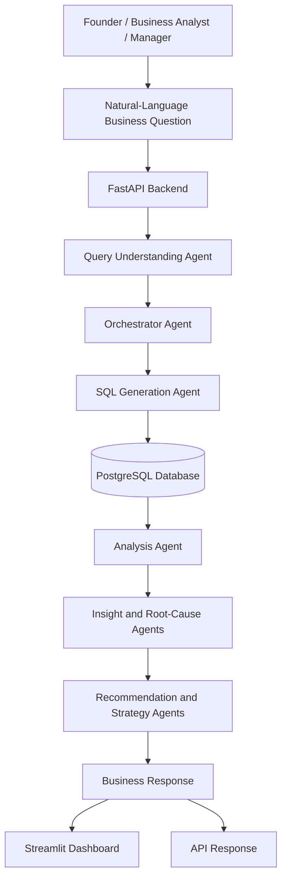

# Agentic AI for E-Commerce Business Intelligence & Strategic Decision Support

> **Tagline:** See what happened → Understand why → Know what to do next.

An AI-powered Business Intelligence (BI) platform designed to help e-commerce decision-makers analyze business performance through natural-language questions, KPI analysis, visualizations, AI-generated insights, root-cause investigation, and strategic recommendations.

---

## Table of Contents

1. [Project Overview](#project-overview)
2. [Problem Statement](#problem-statement)
3. [Project Objectives](#project-objectives)
4. [Target Users](#target-users)
5. [Core Concept](#core-concept-see--understand--act)
6. [Key Features](#key-features)
7. [System Architecture](#system-architecture)
8. [AI Agent Responsibilities](#ai-agent-responsibilities)
9. [Technology Stack](#technology-stack)
10. [Dataset](#dataset)
11. [Project Structure](#project-structure)
12. [Prerequisites](#prerequisites)
13. [Installation and Setup](#installation-and-setup)
14. [Running the Application](#running-the-application)
15. [API Documentation](#api-documentation)
16. [Example Business Questions](#example-business-questions)
17. [Data Analysis Considerations](#data-analysis-considerations)
18. [Testing](#testing)
19. [CI/CD Pipeline](#cicd-pipeline)
20. [Security](#security)
21. [Future Enhancements](#future-enhancements)
22. [Contributing](#contributing)
23. [License](#license)

---

## 1. Project Overview

E-commerce businesses generate large volumes of data across sales, customers, products, marketing campaigns, inventory, returns, payments, and delivery operations. Although traditional BI dashboards present business metrics, decision-makers often need to manually investigate multiple reports to understand what changed, why it changed, and what action should be taken.

**Agentic AI for E-Commerce Business Intelligence & Strategic Decision Support** aims to simplify this process by combining Business Intelligence with AI-powered analysis and recommendation capabilities.

The platform is designed to accept natural-language business questions, retrieve relevant information from a PostgreSQL database, analyze business performance, and generate insights that help decision-makers make data-driven decisions.

The project focuses on **B2C e-commerce and online retail**, using a synthetic India-focused dataset for development and analytical demonstrations.

### Project Vision

Transform traditional business reporting into an intelligent decision-support workflow.

**Traditional BI:**

Data → Dashboard → Manual Analysis → Decision

**Proposed Agentic BI:**

Data → Business Question → AI Analysis → Root-Cause Investigation → Strategic Recommendation → Decision

---

## 2. Problem Statement

E-commerce businesses generate extensive transactional and operational data, but extracting meaningful insights from this data can be time-consuming.

Business owners and analysts often face the following challenges:

- Difficulty understanding changes in revenue, profit, and other KPIs.
- Manual investigation of business performance across multiple dashboards.
- Difficulty identifying potential reasons for declining profitability.
- Limited visibility into relationships between discounts, marketing, returns, inventory, and sales.
- Time-consuming preparation of analytical explanations and business recommendations.
- Delays in converting data into actionable business decisions.

### Proposed Solution

Develop an Agentic AI-powered Business Intelligence platform that combines KPI visualization, natural-language querying, AI-assisted analysis, root-cause investigation, and strategic recommendations in a unified workflow.

The objective is to help decision-makers move beyond understanding what happened to investigating why it happened and identifying what to do next.

---

## 3. Project Objectives

The primary objectives are:

1. Enable users to ask business questions in natural language.
2. Interpret business intent, metrics, filters, and date ranges.
3. Generate and execute appropriate SQL queries against PostgreSQL.
4. Analyze retrieved data to calculate and compare business KPIs.
5. Present relevant business metrics and visualizations.
6. Generate insights based on analytical results.
7. Investigate potential root causes using available evidence.
8. Recommend practical actions to improve business performance.
9. Support maintainable development, testing, version control, and CI/CD.

---

## 4. Target Users

| User | Purpose |
|---|---|
| Founder / CEO | Understand business health and prioritize strategic decisions. |
| Business Owner | Monitor revenue, profit, products, and operational performance. |
| Business Analyst | Investigate KPI changes and answer analytical questions. |
| BI Consultant | Convert business data into insights and recommendations. |
| Marketing Manager | Analyze marketing performance and identify improvement opportunities. |
| Strategy Consultant | Evaluate business performance and recommend strategic actions. |

---

## 5. Core Concept: SEE → UNDERSTAND → ACT

The platform follows a three-stage decision-support philosophy.

### SEE — Business Performance

Present business KPIs and visualizations, such as:

- Revenue and profit.
- Orders and sales trends.
- Product and category performance.
- Marketing performance.
- Returns and delivery metrics.
- Inventory-related indicators.

### UNDERSTAND — AI-Assisted Analysis

Analyze retrieved data to explain performance changes and investigate possible drivers.

For example, if revenue increases while profit decreases, the system can investigate whether discounts, costs, product mix, or other available metrics may help explain the difference.

Explanations should distinguish observed facts from hypotheses and avoid presenting unsupported correlations as proven causes.

### ACT — Strategic Recommendations

Translate analytical findings into actionable next steps.

Recommendations should, where possible, identify the suggested action, its rationale, the expected business impact, and a metric for measuring success.

**Intended output sequence:**

Numbers → Visualization → Insight → Recommendation

---

## 6. Key Features

The project contains backend, dashboard, database, and AI-agent modules intended to support the following capabilities.

### Natural-Language Business Queries

Users can express business questions in natural language instead of manually writing SQL queries.

### AI Agent Orchestration

An orchestrator coordinates relevant agent components according to the business question and processing requirements.

### SQL Generation and Data Retrieval

The SQL-generation component converts interpreted requests into database queries and retrieves relevant data.

Generated SQL should be validated and restricted to permitted operations before execution.

### KPI and Trend Analysis

Analyze business metrics, compare performance across time periods, and identify relevant changes in the available data.

### AI-Generated Insights

Convert analytical results into concise, business-oriented explanations.

### Root-Cause Investigation

Investigate possible drivers of observed performance changes using relevant data from business domains.

### Marketing Analysis

Examine marketing-related metrics and identify potential performance issues.

### Cross-Domain Analysis

Explore relationships across business areas such as sales, marketing, returns, and inventory.

### Strategic Recommendations

Translate findings into practical actions and priorities.

### Interactive Dashboard and API

Use the Streamlit dashboard for the user interface and FastAPI for backend endpoints.

> **Implementation status:** The availability and behavior of each capability depend on the current source code. PDF report generation, scheduled email reporting, and a dedicated Reports page are future enhancements rather than completed features.

---

## 7. System Architecture

The following diagram illustrates the intended high-level system workflow.



### Architecture Layers

**1. Presentation Layer**
- Streamlit dashboard.
- Natural-language business question interface.
- KPI and visualization presentation.

**2. Application Layer**
- FastAPI endpoints.
- Query understanding.
- Agent orchestration.
- SQL generation.
- Analysis and recommendation logic.

**3. Data Layer**
- PostgreSQL database.
- Customers, products, orders, order items, marketing, returns, payments, inventory, delivery, and targets.

**4. Insight and Decision-Support Layer**
- KPI analysis.
- Insight generation.
- Root-cause investigation.
- Strategic recommendations.

**5. Development and Delivery Layer**
- Git and GitHub version control.
- GitHub Actions workflows.
- Testing and deployment steps, depending on the configured pipeline.

The architecture represents the intended workflow. Actual agent routing and deployment behavior should be verified against the current implementation and workflow configuration.

---

## 8. AI Agent Responsibilities

The project contains the following agent modules under `backend/app/agents/`.

| Agent | Responsibility |
|---|---|
| Query Understanding Agent | Interprets business questions, intent, metrics, filters, and time periods. |
| Orchestrator Agent | Coordinates the workflow and determines which processing steps are needed. |
| SQL Generation Agent | Generates database queries based on the interpreted request. |
| Analysis Agent | Analyzes retrieved data, KPIs, comparisons, and trends. |
| Insight Agent | Produces concise business insights from analytical results. |
| Root-Cause Agent | Investigates possible explanations for observed performance changes. |
| Marketing Agent | Examines marketing-related performance metrics. |
| Cross-Domain Agent | Investigates relationships across multiple business domains. |
| Recommendation Agent | Suggests practical actions based on analytical findings. |
| Strategy Agent | Helps prioritize broader business actions and strategic decisions. |

Not every business question requires every agent. The orchestrator should use the relevant components for the requested analysis.

The quality of the final answer depends on the accuracy of the SQL query, the retrieved data, the analytical calculations, and the evidence supporting the generated explanation.

---

## 9. Technology Stack

| Component | Technology |
|---|---|
| Programming Language | Python |
| Backend Framework | FastAPI |
| API Server | Uvicorn |
| Dashboard | Streamlit |
| Database | PostgreSQL |
| Database Containerization | Docker and Docker Compose |
| Data Sources | CSV datasets |
| Version Control | Git |
| Repository Hosting | GitHub |
| CI/CD | GitHub Actions workflow configuration |
| AI Processing | Python-based agent modules |

For the authoritative dependency and database configuration, refer to:

- `backend/requirements.txt`
- `docker-compose.yml`
- `.env.example`
- `.github/workflows/`

---

## 10. Dataset

The project uses a **synthetic India-focused e-commerce dataset** for development, testing, and demonstrations. It is not confidential data from a real retailer.

The `dataset/` directory contains ten CSV files.

| Dataset File | Description |
|---|---|
| `customers.csv` | Customer information. |
| `products.csv` | Product details and categories. |
| `orders.csv` | Order-level information. |
| `order_items.csv` | Individual items within orders. |
| `marketing_campaigns.csv` | Marketing campaign and channel metrics. |
| `returns.csv` | Return-related information. |
| `payments.csv` | Payment records and related information. |
| `inventory.csv` | Inventory and stock-related information. |
| `delivery.csv` | Delivery and fulfillment records. |
| `targets.csv` | Business targets for comparison. |

These datasets enable analysis across sales, profitability, customer behavior, marketing, inventory, returns, payments, and delivery.

### Data Interpretation

- Refer to `database/schema.sql` to understand the database schema and relationships.
- Confirm the grain of each table before combining data.
- Avoid double-counting order totals when joining order-level and item-level records.
- Validate KPI definitions before comparing results.
- Treat findings from synthetic data as demonstrations rather than conclusions about a real business.
- Distinguish correlation from causation when explaining performance changes.

---

## 11. Project Structure

```text
E-Commerce_Agentic_P1/
│
├── .github/
│   └── workflows/                 # GitHub Actions workflow files
│
├── backend/
│   ├── app/
│   │   ├── agents/
│   │   │   ├── analysis_agent.py
│   │   │   ├── cross_domain_agent.py
│   │   │   ├── insight_agent.py
│   │   │   ├── marketing_agent.py
│   │   │   ├── orchestrator_agent.py
│   │   │   ├── query_understanding_agent.py
│   │   │   ├── recommendation_agent.py
│   │   │   ├── root_cause_agent.py
│   │   │   ├── sql_generation_agent.py
│   │   │   └── strategy_agent.py
│   │   │
│   │   ├── api/
│   │   │   ├── analytics.py
│   │   │   ├── category.py
│   │   │   ├── dashboard.py
│   │   │   ├── kpi.py
│   │   │   ├── product.py
│   │   │   ├── query.py
│   │   │   └── root_cause.py
│   │   │
│   │   ├── database/
│   │   │   └── database.py
│   │   │
│   │   ├── services/
│   │   ├── __init__.py
│   │   └── main.py
│   │
│   ├── load_data.py
│   ├── requirements.txt
│   └── test_insight.py
│
├── dashboard/
│   └── app.py
│
├── data/
├── database/
│   └── schema.sql
│
├── dataset/
│   ├── customers.csv
│   ├── delivery.csv
│   ├── inventory.csv
│   ├── marketing_campaigns.csv
│   ├── order_items.csv
│   ├── orders.csv
│   ├── payments.csv
│   ├── products.csv
│   ├── returns.csv
│   └── targets.csv
│
├── frontend/
├── tests/
├── .env.example
├── .gitignore
├── docker-compose.yml
├── Agentic E-Commerce BI Architecture.png
└── README.md
```

Some directories may be empty or gain additional files during development. This tree describes the main project layout.

---

## 12. Prerequisites

Before running the project, install:

- Python compatible with `backend/requirements.txt`.
- Git.
- Docker Desktop with Docker Compose.
- PowerShell or another supported terminal.
- An AI provider API key if required by the current implementation.

Ensure that the required environment variables and database settings are configured before starting the application.

---

## 13. Installation and Setup

The following commands assume Windows PowerShell and a project directory named `C:\E-Commerce_Agentic_P1`.

### Step 1: Clone the Repository

```powershell
git clone https://github.com/TejasManindra/E-Commerce_Agentic_P1.git
cd E-Commerce_Agentic_P1
```

If the repository is already cloned, navigate to your existing project directory instead.

### Step 2: Create a Virtual Environment

```powershell
python -m venv venv
```

Activate the environment:

```powershell
.\venv\Scripts\Activate.ps1
```

### Step 3: Install Dependencies

```powershell
python -m pip install --upgrade pip
pip install -r backend\requirements.txt
```

### Step 4: Configure Environment Variables

Create a local `.env` file from the example:

```powershell
Copy-Item .env.example .env
```

Open `.env` and configure the required database credentials, API keys, and other settings according to the application code.

**Never commit `.env` or actual API keys and passwords to GitHub.**

### Step 5: Start PostgreSQL

From the project root, run:

```powershell
docker compose up -d
```

Check the running services:

```powershell
docker compose ps
```

Confirm the database name, username, password, and port in `docker-compose.yml`.

The local development setup has used PostgreSQL on port `5432`, database `ecommerce_bi`, and username `ecommerce_user`. The current Compose configuration should be treated as the source of truth.

### Step 6: Initialize the Database and Load Data

Review the schema and loader before importing the CSV files:

```powershell
Get-Content database\schema.sql
Get-Content backend\load_data.py
```

Execute the schema initialization and data-loading steps supported by the current project implementation.

Starting the PostgreSQL container alone does not necessarily create all tables or import the CSV datasets.

---

## 14. Running the Application

Run the backend and dashboard in separate PowerShell terminals.

### Start the FastAPI Backend

```powershell
cd C:\E-Commerce_Agentic_P1
.\venv\Scripts\Activate.ps1
cd backend
uvicorn app.main:app --reload
```

The API should be available at:

- **API base URL:** `http://127.0.0.1:8000`
- **Swagger documentation:** `http://127.0.0.1:8000/docs`

### Start the Streamlit Dashboard

Open another terminal:

```powershell
cd C:\E-Commerce_Agentic_P1
.\venv\Scripts\Activate.ps1
streamlit run dashboard\app.py
```

The dashboard is typically available at:

`http://localhost:8501`

Use the address shown in the terminal if Streamlit selects a different port.

---

## 15. API Documentation

FastAPI provides interactive API documentation for inspecting endpoints, request schemas, parameters, and responses.

After starting the backend, open:

`http://127.0.0.1:8000/docs`

The current API modules include endpoints related to:

- Analytics.
- Categories.
- Dashboard metrics.
- KPIs.
- Products.
- Natural-language queries.
- Root-cause analysis.

Use the request formats displayed in Swagger. The exact input and output schemas depend on the endpoint implementation.

---

## 16. Example Business Questions

The platform is intended to support questions such as:

1. Why did profit decrease even though revenue increased?
2. Show the revenue for the previous three months.
3. Which product categories contribute the most profit?
4. How are discounts affecting profitability?
5. Which marketing channels show weak performance?
6. Are product returns increasing in any category?
7. Where could inventory shortages be limiting sales?
8. Which products are performing below expectations?
9. What factors may be contributing to declining profit margins?
10. What should the business prioritize to improve profitability?

A useful analytical response should include relevant numbers, the time period being analyzed, comparisons with an appropriate baseline, evidence-supported insights, and measurable recommendations.

---

## 17. Data Analysis Considerations

Reliable business intelligence depends on correct data retrieval and interpretation.

### KPI Definitions

Revenue, gross profit, net profit, order value, and profit margin are different metrics. Define each calculation explicitly before comparing results.

### Correct Aggregation

Order-level, order-item-level, customer-level, and monthly marketing records have different levels of detail. Joins and aggregations must account for those differences.

### Date-Range Handling

Use clear date boundaries for time-based queries. For monthly analysis, an inclusive start date and exclusive end date can help avoid missing records with time components.

### SQL Safety

Generated SQL should be validated before execution. Restrict permitted operations and tables, use parameterized filters where appropriate, and prefer read-only database credentials for analytical queries.

### Evidence-Based Insights

Verify the returned data before generating explanations. Empty results, duplicate joins, missing values, or incorrect date filters can lead to misleading conclusions.

### Recommendations

Recommendations should be connected to the observed evidence. When a cause cannot be established, present it as a possible explanation rather than a proven fact.

---

## 18. Testing

The repository contains an insight-related test script at:

`backend/test_insight.py`

Test coverage should include:

- Query understanding and intent classification.
- Date-range interpretation.
- SQL generation and validation.
- Database connectivity.
- KPI calculations and aggregations.
- Agent orchestration.
- Empty or invalid query results.
- API error handling and response formats.
- Dashboard startup and major user flows.

If the project has compatible pytest tests installed and configured, start with:

```powershell
pytest
```

Run the tests supported by the actual project configuration and resolve failures before deploying changes.

---

## 19. CI/CD Pipeline

The repository contains a `.github/workflows/` directory for GitHub Actions workflow configuration.

A recommended CI/CD workflow can include the following stages.

### Continuous Integration (CI)

1. Trigger on pushes and pull requests.
2. Set up the required Python version.
3. Install project dependencies.
4. Run formatting and lint checks.
5. Execute automated tests.
6. Validate application imports and configuration.
7. Build a Docker image if a suitable Docker build is configured.

### Continuous Delivery / Deployment (CD)

1. Start only after required CI checks pass.
2. Build or retrieve the validated application artifact.
3. Publish the artifact or container image if configured.
4. Deploy to the selected hosting environment.
5. Perform health checks.
6. Keep credentials in GitHub Secrets or the hosting provider's secret manager.

### Git Workflow

To commit and push changes:

```powershell
git add -A
git diff --cached --check
git commit -m "Describe your changes"
git push origin main
```

For larger changes, use a feature branch and open a pull request.

> **Important:** A workflow directory does not automatically mean a complete CI/CD pipeline is operational. Verify the workflow YAML files and successful GitHub Actions runs before describing the pipeline as fully working. Deployment also depends on configured infrastructure and secrets.

---

## 20. Security

Follow these practices during development and deployment:

- Do not commit `.env` files, passwords, API keys, or access tokens.
- Keep `.env.example` limited to placeholder values.
- Use least-privilege database accounts.
- Prefer read-only credentials for analytical queries.
- Validate generated SQL before executing it.
- Avoid exposing sensitive data in logs or API responses.
- Do not use synthetic-data findings as evidence about a real company's performance.
- Review authentication, authorization, and privacy requirements before connecting real business data.

---

## 21. Future Enhancements

Potential future improvements include:

- Stronger SQL validation and database access controls.
- Automated tests covering all agents and API endpoints.
- Improved error handling, logging, retries, and observability.
- Evidence references linking insights to the data behind them.
- Evaluation datasets for measuring analysis and recommendation quality.
- PDF report generation.
- A dedicated Reports page.
- Scheduled reports and email delivery.
- Improved dashboard usability and visualization options.
- Containerized application deployment.
- Verified end-to-end CI/CD automation.
- Authentication and role-based access control.
- Production monitoring and deployment health checks.

These are proposed enhancements and should not be considered implemented until the corresponding code and workflows are completed and tested.

---

## 22. Contributing

Contributions and improvements should follow a structured workflow.

1. Create a feature branch.
2. Make a focused change.
3. Run relevant tests.
4. Review the Git diff.
5. Check for accidental secrets and unrelated changes.
6. Commit and push the change.
7. Open a pull request when using a collaborative workflow.

Example:

```powershell
git checkout -b feature/your-change
git add -A
git diff --cached --check
git commit -m "Describe your change"
git push -u origin feature/your-change
```

---

## 23. License

No license has been specified in this README. Add an appropriate `LICENSE` file if you intend to distribute the project under a particular open-source license.
